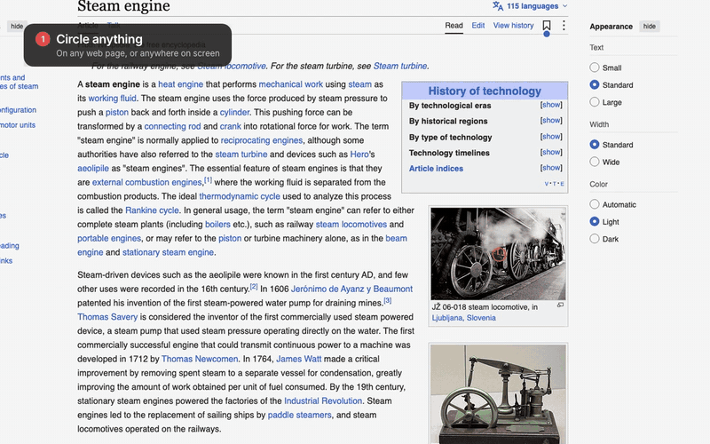

# Chalktalk

**Circle anything on your screen. Ask out loud. Your coding agent answers right there.** It underlines
the real buttons and fields, sketches what happens behind them on a whiteboard (in 3D when the shape
matters), and explains it out loud, one plain step at a time.

[](media/chalktalk-demo.mp4)

▶ [Watch the full 80-second demo, with sound](media/chalktalk-demo.mp4)

## A HeyClicky alternative with no subscription

Screen-aware AI tutors like HeyClicky are separate apps with their own monthly plans. Chalktalk is a
free, open-source skill for the agent you already pay for:

- **Runs on any agent harness.** Claude Code, OpenCode, Codex, or a DeepSeek model behind any of them.
  The brains are whatever model you already run; Chalktalk is one `SKILL.md` plus a small local helper.
- **No subscription, no account.** MIT licensed. Nothing leaves your machine except what your own
  agent sends to its own model.
- **Talk to it.** Apple dictation (or any dictation app) types straight into the question box.
- **It talks back for free.** Kokoro, an open-source voice, runs locally. ElevenLabs is optional if you
  want a more natural voice.
- **Any app, not just the browser.** A Chrome bookmark for web pages and a small desktop app (Mac,
  Windows, Linux) for everything else on screen.

## Install (about 5 minutes)

Needs [Bun](https://bun.sh), an agent that runs shell commands (Claude Code, OpenCode, Codex, Gemini
CLI, Cursor and the like), and Chrome.

**On any agent:** `npx skills add 0x0elliot/chalktalk` installs the skill where your agent looks for it
(OpenCode `~/.config/opencode/skills`, Codex `~/.agents/skills`, Gemini CLI `~/.gemini/skills`, Cursor
`~/.cursor/skills`). Then run `bun install` inside the installed folder and start it by asking your agent
to "use chalktalk". The steps below are the Claude Code route, which also builds the desktop app.

1. **Get the skill.**

   ```bash
   git clone https://github.com/0x0elliot/chalktalk.git ~/chalktalk
   ~/chalktalk/install.sh
   ```

   `install.sh` links the folder into `~/.claude/skills/chalktalk`, so every Claude Code session can use it.

2. **Start listening.** In any Claude Code session, type `/chalktalk listen`. It starts a small helper on
   your machine (`127.0.0.1:47321`, never reachable from the network) and waits for your questions.

3. **Add the bookmark.** Run `bun ~/chalktalk/bookmarklet.ts ~/Desktop`, open the page it writes, and
   drag the red **Chalktalk** button onto your bookmarks bar (Cmd+Shift+B shows the bar). The bookmark
   only loads the latest code from the helper, so you never reinstall it.

   The bookmark carries a key made on your computer (`~/.chalktalk/key`). The helper ignores any page
   that doesn't present it, so a website you visit can't send your agent notes or read your lessons.
   The desktop app doesn't need the key: the helper recognises it by its app origin.

4. **Allow each site once.** The first time you click Chalktalk on a site, Chrome asks whether the page
   may reach apps on this device. Click **Allow**.

## The desktop app: any app, not just web pages

The desktop app works over anything on screen (Slack, Mail, Figma, a terminal) and on sites that block
the bookmark. It is a Tauri app, about 6 MB, that draws a see-through layer over your screen; clicks
pass through to your apps everywhere except on its own boxes.

1. Install Rust from [rustup.rs](https://rustup.rs). On Linux also install the system packages:
   `sudo apt install libwebkit2gtk-4.1-dev libayatana-appindicator3-dev librsvg2-dev`.
2. `/chalktalk listen` starts it for you. The first time it builds the app (about 5 minutes); after that
   it starts in a second. By hand: `bun ~/chalktalk/desktop.ts start` (also `stop`, `rebuild`, `status`).
3. Press **⌃⌥C** (Control+Option+C) on a Mac, or **Ctrl+Alt+C** on Windows and Linux, anywhere. Circle,
   type or dictate, and press Cmd+Enter (Ctrl+Enter on Windows and Linux). The same hotkey or Esc closes it.
   Just want to ask something, no drawing? **⌃⌥A** (Ctrl+Alt+A) opens the question box straight away.
4. Allow screen recording when your system asks (on a Mac: System Settings, Privacy & Security, Screen
   Recording), so Claude can see what you circled. Restart the app after allowing it.

On Linux with Wayland, the system blocks global hotkeys and overlays, so the app runs itself through
XWayland.

## Using it

1. Click **Chalktalk** on any page (or press the desktop hotkey). The page dims slightly.
2. Circle what you mean, or press Enter without circling to ask about the whole page.
3. Talk or type your question in the box (dictation apps type straight in), then press Cmd+Enter.
4. A box on the right shows "<your model> is thinking", a one-line answer, and a numbered plan (the name
   comes from `--as`, so it says "DeepSeek V4.1 Flash is thinking" or "Claude is thinking"). The
   explanation then plays where you asked, with Back, Pause, Next, Replay, Clear, Close all, and an Ask
   box for follow-ups. Drawings fade a few seconds after it ends. Every box can be dragged by its
   "⠿ drag to move" grip (double-click puts it back) and closed with its ✕.

Clicking Chalktalk on a page you asked about before offers **Replay** for recent answers, instantly.

## Voice

- **Kokoro** (default): a free, open-source voice model that runs on your machine. The first answer
  installs it into `~/.chalktalk/kokoro` (about 450 MB).
- **ElevenLabs** (optional): more natural; needs an API key. The installer asks once which voice you
  want and where your key lives: an environment variable, the macOS Keychain, Google Cloud Secret
  Manager, or any command that prints it (1Password, Doppler, pass). Chalktalk reads the key when it
  speaks and never stores it. Change your answer any time with `bun ~/chalktalk/setup.ts`.

Switch voices on the fly with **⌃⌥V** on a Mac (**Ctrl+Alt+V** elsewhere); the next answer uses it. If
one engine fails, Chalktalk uses the other and says why.

## Privacy and safety

- The helper only listens on your own machine. Chrome asks you once per site before any page can reach it.
- An answer, its plan, and its replay only go to the tab and site that asked.
- Notes from a site you have never used Chalktalk on are marked as new, and Claude treats them as
  suggestions to confirm rather than instructions.
- Claude investigates read-only and never clicks a setting for you; it shows you where to click.
- Keep Chalktalk off a site for good with `/chalktalk block https://example.com`.

## More than one Claude session

Each session listens under its own name. With two listening, the question box shows **Send to:** so
you pick, and each answer only plays in the tab that asked.

## Troubleshooting

- **"Chalktalk isn't running"**: paste `/chalktalk listen` into a Claude Code session.
- **Nothing happens after Cmd+Enter**: Chrome's "reach apps on this device" prompt was dismissed; allow
  it in the site settings (the icon left of the address bar).
- **No sound**: click once anywhere on the page, then press Replay; browsers only play sound after a click.

## License

MIT
